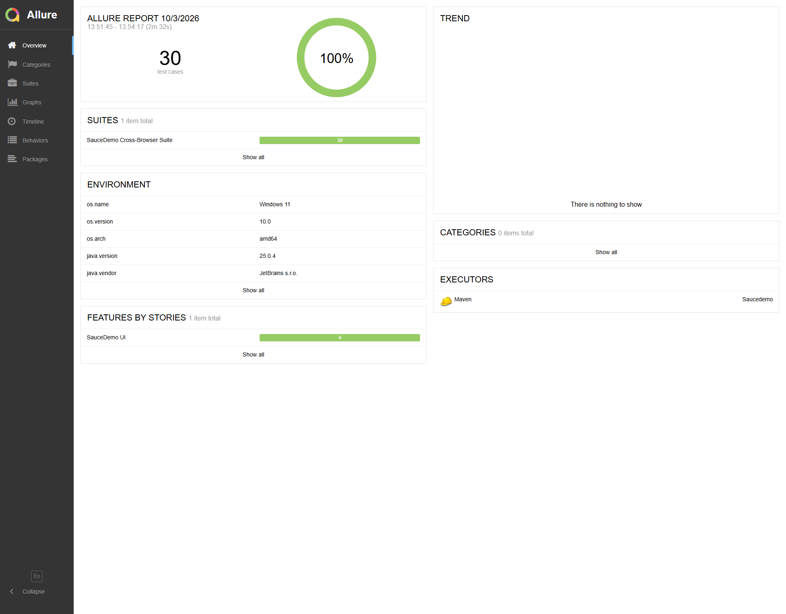
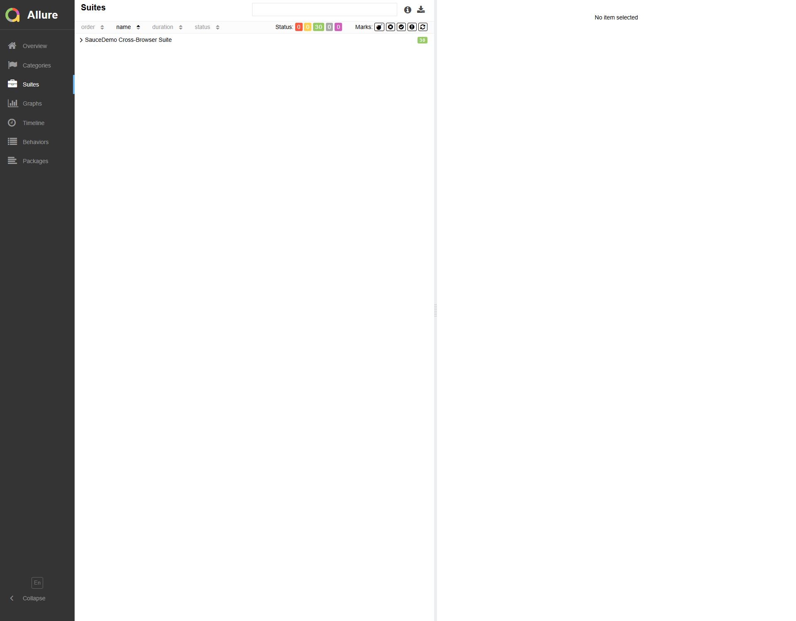
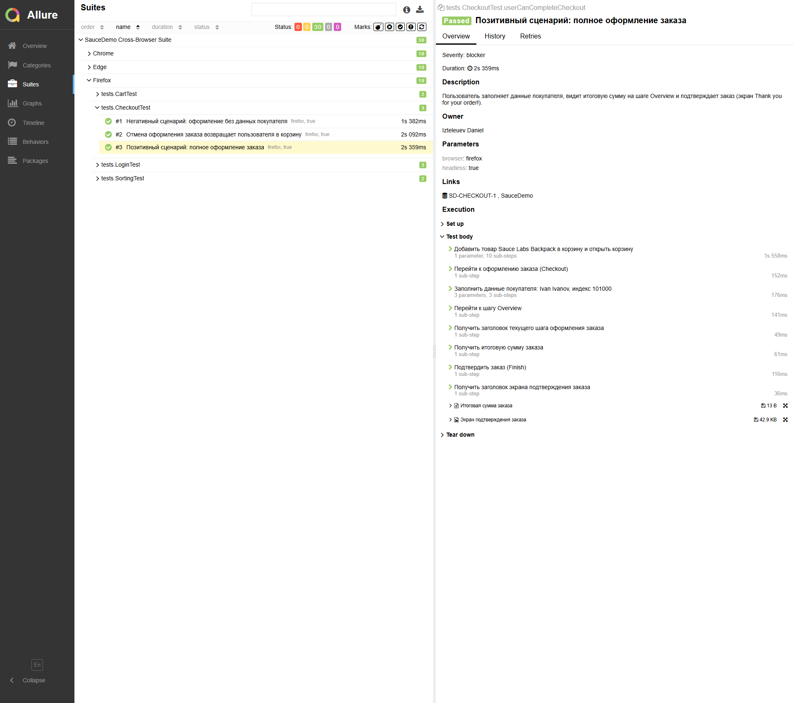
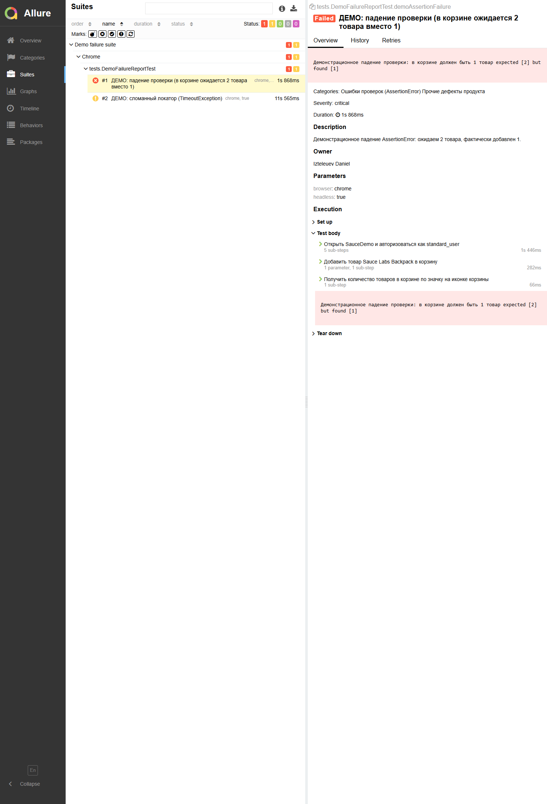
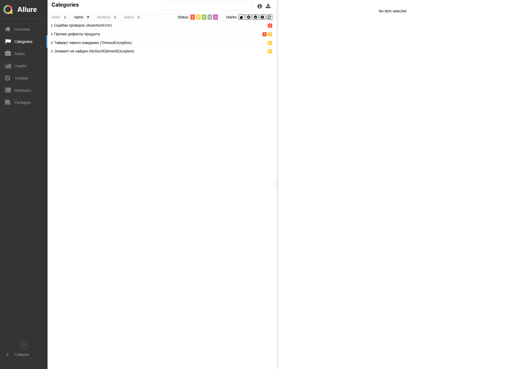
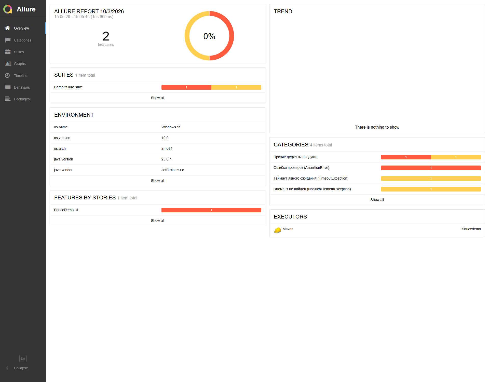
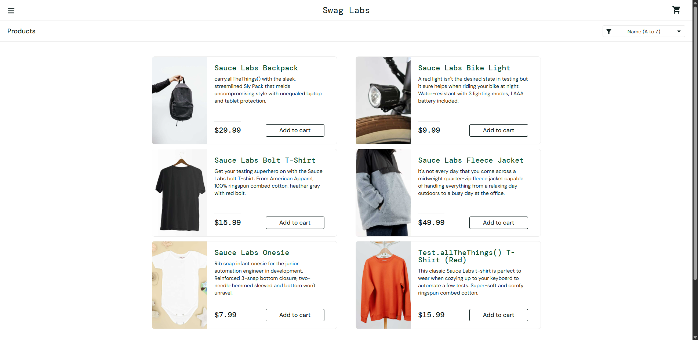

# Izteleuev Daniel Ruslanovich — SauceDemo UI-автотесты (Selenium + TestNG + Allure)

## Сценарии

- [X] Авторизация: позитивный сценарий (`standard_user`)
- [X] Авторизация: заблокированный пользователь (`locked_out_user`)
- [X] Авторизация: неверный пароль (негативный)
- [X] Корзина: добавление товара
- [X] Корзина: удаление товара
- [X] Сортировка: по цене (Low -> High)
- [X] Сортировка: по названию (Z -> A)
- [X] Оформление заказа: полный цикл (Finish)
- [X] Оформление заказа: валидация обязательных полей (негативный)
- [X] Оформление заказа: отмена (Cancel)

## Скриншоты работы

### 1. Кроссбраузерный прогон Dashboard отчёта Allure

### 2. Кроссбраузерность: Chrome / Firefox / Edge в Suites

### 3. Карточка теста: шаги, параметры, метки, вложения

### 4. Карточка упавшего теста со скриншотом (вложение при падении)

### 5. Категории дефектов (`categories.json`)

### 6. Environment и статистика упавшего прогона

### 7. Скриншот, который автотест прикладывает при падении

